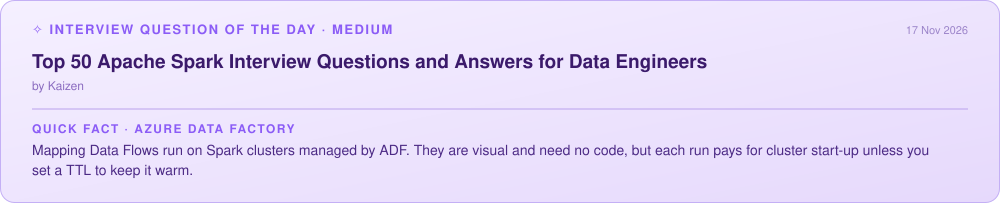

# ✧ Daily Data Engineering Facts

Every morning this repo picks a fresh **article or interview question** on **PySpark & Spark internals, Delta Lake, Azure Data Factory, Microsoft Fabric** and Databricks from **Medium, Hashnode and dev.to**, plus a quick fact.
Updated automatically by GitHub Actions at 06:00 IST.

📚 **Every past pick is kept forever in the [Archive](ARCHIVE.md)**, one file per day under `archive/YYYY/MM/`.

## Today's pick

<!-- FACT:START -->
### ✧ Interview question of the day

**[Top 50 Apache Spark Interview Questions and Answers for Data Engineers](https://medium.com/@poojatripathi0697/top-50-apache-spark-interview-questions-and-answers-for-data-engineers-2f4428d1537a)** by Kaizen · *Medium*

> A practical interview preparation guide based on my Data Engineering interview experiences Continue reading on Medium »

**Quick fact (Azure Data Factory):** Mapping Data Flows run on Spark clusters managed by ADF. They are visual and need no code, but each run pays for cluster start-up unless you set a TTL to keep it warm.

<sub>updated 2026-11-17</sub>
<!-- FACT:END -->

## As a card



Embed it anywhere (e.g. your profile README):

```md

```

## How it works

Two GitHub Actions run every morning:

1. **Daily fact** (06:00 IST) runs `daily_pick.py`. It reads Medium tag feeds, the dev.to API and the Hashnode API, keeps only relevant posts (no course ads or job posts), and picks one. Odd days favour interview questions, even days favour articles. It updates this README, `fact.svg` and `today.json`.
2. **Archive fact** runs right after it and calls `archive_fact.py`. It saves the pick permanently:
   - `archive/YYYY/MM/YYYY-MM-DD.md`, one file per day
   - `archive/index.json`, every pick ever made
   - `ARCHIVE.md`, the list of all days, newest first

Other details:

- `history.json` remembers every pick so nothing repeats.
- If all sources are down, it falls back to the built-in fact bank in `update_fact.py`.
- No API keys and no cost. Change topics by editing the tag lists at the top of `daily_pick.py`.

All articles belong to their authors; this repo only links to them.

Run it now: **Actions → Daily fact → Run workflow**.
